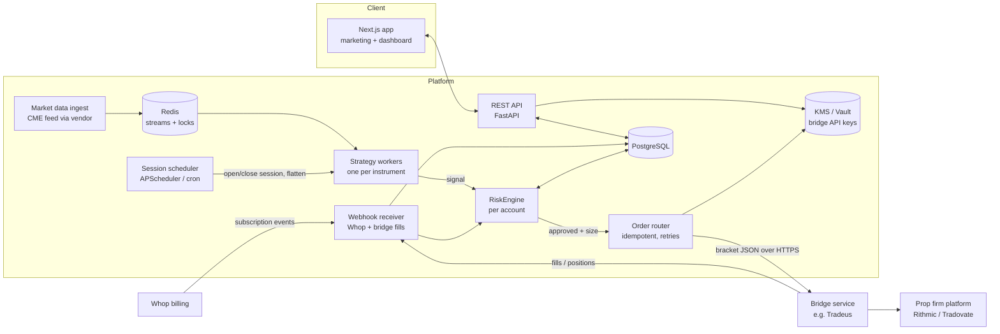

# Prop-Firm Evaluation Bot: Technical Specification

> **Status:** draft for educational and development use. Firm rule values in this document and in
> `risk_engine.py` are **placeholders** and have to be checked against the firm's current rules page
> before use. Nothing here was checked against fundralgo.com, which could not be independently
> verified.

Files in this folder:

| File | Contents |
|---|---|
| `SPEC.md` | Architecture, data flow, API, and operational requirements (this file) |
| `schema.sql` | PostgreSQL schema |
| `risk_engine.py` | The `RiskEngine` class (pure logic, no I/O) |
| `test_risk_engine.py` | 12 unit tests for the rules (`pytest -q`) |

---

## 1. System architecture



### Signal-to-order path

1. **Scheduler** opens one of the 4 sessions. Strategy workers start evaluating bars.
2. **Strategy** emits at most one `Signal` (entry, stop, target, side) per instrument per session.
   It is account-agnostic.
3. For each subscribed account, the **RiskEngine** runs `pre_trade()`. Every check that fails is
   collected and written to `audit_events`, so you can see every reason a trade was blocked.
4. If allowed, the **order router** sends a single bracket order with a deterministic
   `client_order_id` (`{account}:{signal_id}`), so a retry can never double-fill.
5. Fills come back through the bridge webhook. `on_entry()` / `on_close()` update state, which is
   persisted with optimistic locking (`risk_state_version`).
6. Equity marks (every N seconds, or on each fill/price update) go through `check_live()`. Any halt
   reason cancels working orders. `ACCOUNT_FAILED`, `DAILY_LOSS`, `NEAR_FLATTEN` and
   `DRAWDOWN_BUFFER` also flatten the account.
7. **Scheduler** sends a hard flatten to every account at `flatten_by - 5 min`. It also
   independently cancels and flattens at `flatten_by`, as a second line of defence.

### Failure modes the system must handle

| Failure | Required behaviour |
|---|---|
| Bridge webhook down or timing out | Retry with the same `client_order_id`. After 3 failures, pause the account and alert the user. |
| No fill confirmation within X seconds | Query the bridge for positions before doing anything else. Never assume. |
| Market data stale (> 5 s gap) | Strategy emits nothing. Open trades keep their exchange-side brackets. |
| Engine state version conflict | Reload state, re-run the decision. |
| Process restart mid-session | State reloads from DB. Session counters prevent re-entering a session that already took its trade. |
| Position exists that the bot did not open | Pause the account (the user is trading it manually). |

The stop and target **must be exchange-side brackets** (OCO at the broker), so a loss stays capped
even when our servers are down.

---

## 2. Risk rules (implemented in `risk_engine.py`)

| Rule | Implementation |
|---|---|
| Fixed risk per trade | `contracts = floor(min(balance × risk_pct, room_to_floor, room_to_daily_limit) / (stop_ticks × tick_value))`. |
| EOD trailing drawdown | At each trading-day rollover (18:00 ET): `floor = max(floor, min(eod_balance − max_loss, lock_level))`. The floor only moves up. Live equity ≤ floor means the account has failed; equity ≤ floor + buffer halts trading. |
| Consistency (40%) | Today's profit `d` is capped so that `d ≤ r·(P + d)`, i.e. `d ≤ r/(1−r)·P` where `P` = prior days' profit. The cap is never lower than `r × target`, since every day ≤ r × target is always compliant once the target is hit. A 90% safety factor is applied. **Before entry**, the engine checks that the *full target* would fit under the cap, and reduces size or rejects the trade if not. |
| One loss ends session | Losses are counted per `{trading_day}:{session}` key, against the session in which the trade was **opened**. |
| One setup per session | `max_trades_per_session = 1`. |
| Daily loss limit | Uses the tighter of the bot limit and the firm limit. Pre-trade sizing makes sure a full stop-out cannot cross it. |
| Time rules | No new entries 5 min before `flatten_by` (16:45 ET). Forced flat from 16:45 until 18:00 rollover. |
| Target reached | Stop trading the account; status → `passed`. |

The engine **fails closed**: an invalid input raises an error, and an unknown session is rejected.

Points to resolve with the firm's current rules:
- Is the EOD drawdown measured on the **balance** or on the **peak unrealized equity at the close**?
  Firms differ. The engine assumes balance.
- Exact lock level, consistency ratio (it can differ between the evaluation and funded stages), and
  whether a daily loss limit exists.
- **Whether automated trading or third-party copy tools are allowed at all.** This is the biggest
  risk to the whole product.

---

## 3. REST API

Base path `/api/v1`. Auth: session cookie (web) or bearer JWT. All money values are decimal strings.

### Accounts
| Method | Path | Purpose |
|---|---|---|
| `GET` | `/accounts` | List the user's accounts, with status, balance, floor, distance to target and floor, and today's P&L |
| `POST` | `/accounts` | Connect an account (body below). Returns `201` with the account in `paused` state. |
| `GET` | `/accounts/{id}` | Detail, including the pinned rule set and a summary of the current risk state |
| `PATCH` | `/accounts/{id}` | Change `label`, `risk_config` overrides (validated against firm limits), `instrument` |
| `POST` | `/accounts/{id}/enable` | Turn the bot on. Requires an active subscription, risk acknowledgement, and a successful bridge test. |
| `POST` | `/accounts/{id}/pause` | Turn the bot off. Optional `{"flatten": true}` also closes positions. |
| `POST` | `/accounts/{id}/test-connection` | Ping the bridge with the stored credentials |
| `DELETE` | `/accounts/{id}` | Archive it and delete the secret from the vault |
| `POST` | `/bot/pause-all` | Global kill switch for this user |

`POST /accounts` body:
```json
{
  "label": "Lucid 50K #1",
  "firm": "lucidflex",
  "account_size": "50000",
  "bridge": "tradeus",
  "bridge_account_ref": "acct_abc123",
  "bridge_api_key": "sk_live_...",
  "instrument": "MNQ",
  "starting_balance": "50000",
  "current_balance": "50000"
}
```
`bridge_api_key` goes straight to the vault and is never returned. The prop firm's own login
credentials are never accepted.

### Journal and metrics
| Method | Path | Purpose |
|---|---|---|
| `GET` | `/trades?account_id=&from=&to=&status=&cursor=&limit=50` | Trade journal, cursor-paginated, newest first |
| `GET` | `/trades/{id}` | Trade, its signal, and its audit trail (every risk decision and order event) |
| `GET` | `/accounts/{id}/daily` | `daily_results` rows: P&L per day, floor after each day, and the largest-day ratio |
| `GET` | `/accounts/{id}/metrics?from=&to=` | Win rate, profit factor, average R, max drawdown, trade count |
| `GET` | `/accounts/{id}/events?kind=` | Raw audit log |
| `GET` | `/stream` (SSE) | Live trade, halt and equity events for the dashboard |

Metric definitions:
- **Win rate** = wins / closed trades.
- **Profit factor** = gross profit / |gross loss|.
- **Average R** = mean(pnl / risk_usd).

All three are computed net of fees.

### Billing and webhooks
| Method | Path | Purpose |
|---|---|---|
| `GET` | `/billing` | Plan, renewal date, account limit, and a link to the Whop portal |
| `POST` | `/webhooks/whop` | Subscription lifecycle. On cancel or expiry, pause all accounts (flatten first). |
| `POST` | `/webhooks/bridge` | Fills and position updates (HMAC-verified, idempotent on event id) |

---

## 4. Security
- Bridge API keys are encrypted in KMS/Vault. The database stores only `bridge_secret_ref`.
- Webhooks are HMAC-verified with a timestamp tolerance, and replays are rejected.
- Order-sending and API workers are separate processes. Only the order router can read secrets.
- The order router enforces a per-account rate limit and a contract-size ceiling, independently of
  the RiskEngine.

## 5. Compliance and product copy
- Before the bot can be enabled, the user must accept a disclosure that includes: *"Automated
  trading involves risk of loss; passing, funding and payouts are never guaranteed."* and *"It is
  your responsibility to confirm your firm permits automated trading."* Acceptance is stored in
  `users.risk_ack_at`.
- Testimonials need a "results not typical" disclaimer, and should be backed by real records. In
  the US, the FTC endorsement rules apply, and get legal review on whether signal or automation
  marketing touches CFTC/NFA rules.
- Never publish pass rates or P&L that cannot be backed by audit logs.

## 6. Build plan
1. RiskEngine, schema, and a backtest harness that replays historical bars through `pre_trade` and
   `on_close` (the strategy is useless without this).
2. Bridge adapter, tested against a sim/demo account. Run in paper mode for at least 4 weeks.
3. Dashboard (accounts, journal, kill switch) and Whop billing.
4. Marketing site, written only after real forward-test results exist.
